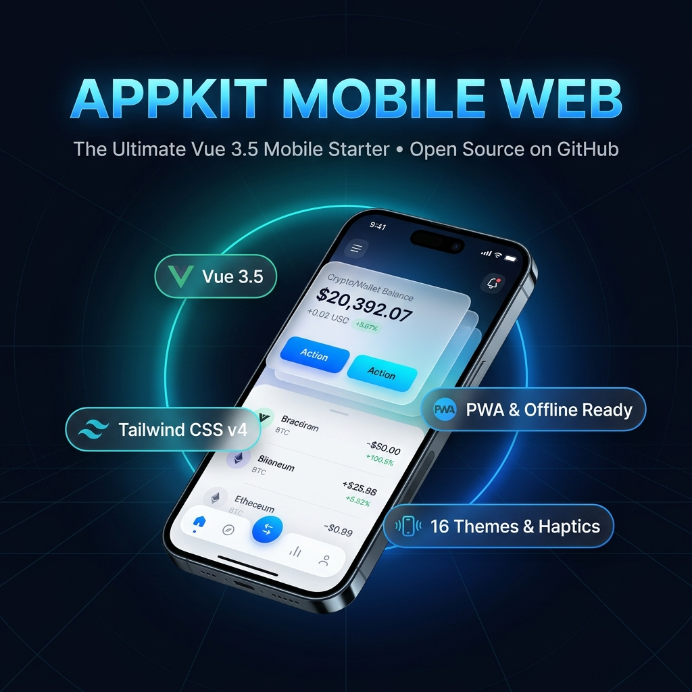

# 📱 AppKit Mobile Web — Vue 3.5 PWA Template

<p align="center">
  <strong>Modern Mobile Web Application & PWA Master Template transformed from AppKit Legacy into Vue 3.5, TypeScript & Tailwind CSS v4</strong>
</p>

<p align="center">
  <a href="https://vuejs.org/"></a>
  <a href="https://tailwindcss.com/"></a>
  <a href="https://www.typescriptlang.org/"></a>
  <a href="https://vite.dev/"></a>
  <a href="https://bun.sh/"></a>
  <a href="./LICENSE"></a>
</p>

<p align="center">
  
</p>

> [!TIP]
> ### 📱 FUNGSI & KEGUNAAN FOLDER INI:
> **`apps/mobile-web-starter`** adalah **Template Aplikasi Mobile Web (PWA) untuk Pengguna Akhir**.
> - **Untuk siapa?** Pengguna mobile yang membuka website/aplikasi Anda di browser ponsel.
> - **Apa isinya?** Aplikasi mobile utuh dengan alur Dompet/Wallet, Form KYC (OTP 6 digit), Login/Register, navigasi 5-tab native, getaran haptic, dan dark mode.
> - **Bedanya dengan Script Hub?** Jika Anda seorang programmer yang ingin mencari contoh potongan kode dan mencopy script komponen satuan (*1-click "Ambil Script"*), gunakan **`apps/developer-script-hub`**.

---

## 🌟 Overview

**`appkit-mobile-web-starter`** adalah master template aplikasi mobile web modern berperforma tinggi yang dirancang khusus untuk menghadirkan pengalaman native iOS dan Android di browser ponsel modern.

Transformed from the legacy AppKit HTML5/jQuery codebase into clean, reactive Vue 3.5 Composition API code, it eliminates direct DOM queries in favor of single-source-of-truth state management.

---

## ✨ Key Features

- **📱 Authentic Mobile Shell:** 
  - Dynamic Sticky / Scroll Header with back navigation and drawer burger trigger.
  - 5-Tab Mobile Bottom Navigation Bar (`AppFooterBar`) with Center Floating Action Button (Variant 6).
  - Multi-directional Action Sheets, off-canvas Drawer, and Centered Action Confirmation Modals.
- **🎨 16 Dynamic Highlight Color Themes:**
  - Instant theme switching without page reloads (*Blue, Red, Green, Grass, Orange, Yellow, Sunny, Teal, Mint, Pink, Magenta, Brown, Aqua, Night*).
  - Automatic Dark Mode synchronization with OS `prefers-color-scheme` and local storage persistence.
- **📳 Tactile Touch & Web Haptics:**
  - Integrated `useHaptic()` triggering hardware vibration on buttons, switches, tabs, and modals (`navigator.vibrate`).
- **📶 Offline & PWA Ready:**
  - Automatic network connectivity banner (`OfflineDetector`) with sliding transitions.
  - Safe-area insets calculation (`env(safe-area-inset-top)` / `env(safe-area-inset-bottom)`).
- **💼 Pre-built Interactive Views:**
  - **HomeView:** Hero wallet card, quick actions, statistics, and transaction list.
  - **WalletDemoView:** Credit card cover, currency balance, and transfer actions.
  - **FormDemoView:** Floating input, select, switches, steppers, OTP 4-6 digit pins, and file upload preview.
  - **AuthView:** Sign in / Sign up tabbed authentication screen with validation.
  - **ComponentsView:** Live showcase of all interactive primitives.

---

## 🚀 Quick Start

```bash
# Clone repository
git clone <your-repo-url>
cd Appkit-mobile

# Install dependencies via Bun
bun install

# Run Mobile Web Demo (Port 3000)
bun run dev

# Run Component Workbench (Port 3001)
bun run dev:ui
```

Open **`http://localhost:3000`** in your browser (switch to Mobile Device emulation via Developer Tools for the best experience).

---

## 🏗️ Project Structure

```
apps/web/
├── src/
│   ├── assets/styles/     # tokens.css, main.css, transitions.css
│   ├── components/
│   │   ├── card/          # AppCard, ImageCard
│   │   ├── feedback/      # AppBadge, AppToast, AppSnackbar, SkeletonLoader, OfflineDetector
│   │   ├── form/          # AppInput, AppSelect, AppSwitch, AppStepper, AppOtpInput, AppFileUpload
│   │   ├── navigation/    # AppAccordion, AppTabs, ListGroup, ListItem
│   │   ├── shell/         # AppShell, AppHeader, AppFooterBar, PageTitle, AppDrawer, ActionSheet, ActionModal
│   │   └── ui/            # AppButton, AppDivider, SearchBar, StarRating
│   ├── composables/       # useHaptic, useHighlight, useOffline, usePwa, useScrollHeader, useTheme, useToast
│   ├── layouts/           # DefaultLayout, BlankLayout
│   ├── router/            # Vue Router index
│   ├── stores/            # Pinia uiStore
│   └── views/             # HomeView, ComponentsView, FormDemoView, WalletDemoView, AuthView
```

---

## 📄 License

Distributed under the **MIT License**. See [`LICENSE`](../../LICENSE) for details.
